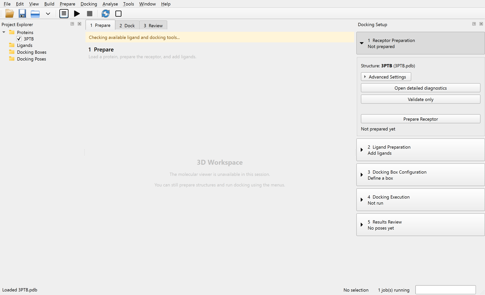
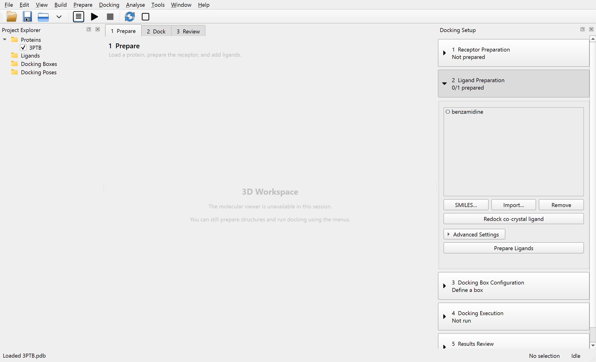
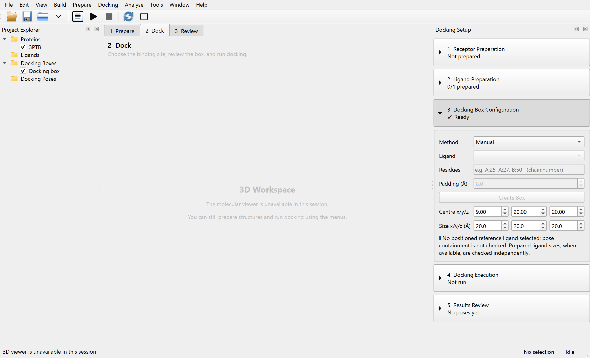
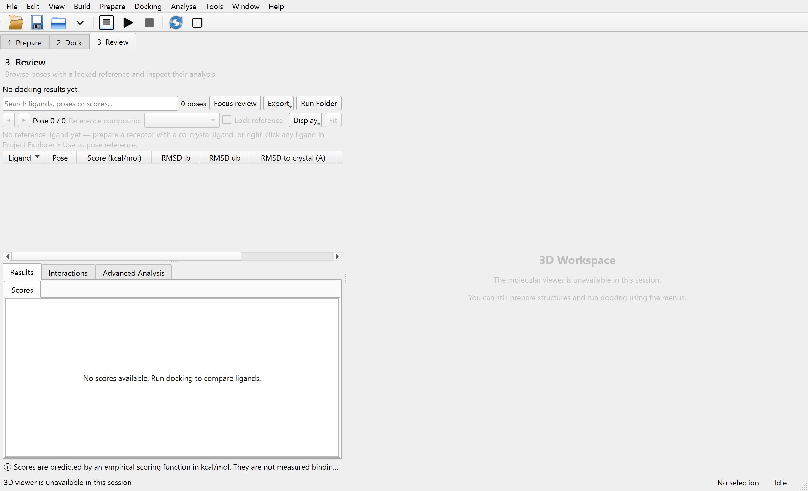

# WaweDock User Guide

**A simple guide to preparing a receptor, running a docking study, and reviewing results**

---

## 1. Before you begin

WaweDock runs protein viewing and editing with fewer dependencies than a full
docking study. Ligand preparation, receptor PDBQT preparation, AutoDock Vina,
and chemistry analysis require the **Full** edition and the optional chemistry
backend.

At the top of the window, a yellow notice means that a required capability is
being checked or is unavailable. Protein viewing, cleanup, and diagnostics
remain available even when ligand and docking tools cannot load.

**Supported protein files**

- PDB: `.pdb`, `.ent`
- mmCIF: `.cif`, `.mmcif`

**Supported ligand files**

- `.sdf`, `.mol`, `.mol2`, `.smi`, `.smiles`
- `.csv`, `.txt`

---

## 2. Understand the main window



### The three workspaces

Use the tabs across the top of the main workspace:

1. **Prepare** — load and prepare proteins and ligands.
2. **Dock** — select the binding site, create a docking box, and run docking.
3. **Review** — inspect poses, scores, and interactions.

### The four main areas

- **Viewer, centre:** shows the molecular structure and docking objects.
- **Project Explorer, left:** lists proteins, ligands, docking boxes, and poses.
- **Docking Setup, right:** contains the numbered preparation and docking steps.
- **Status bar, bottom:** shows messages, job activity, and progress.

Additional panels open from **Window > Panels**:

- **Properties**
- **Selection & Cleanup**
- **Prepare Receptor — Diagnostics**
- **Preparation Report**
- **Log**
- **Jobs**

The Project Explorer controls visibility. A checked item is visible; clearing
the check hides it without deleting it. Right-click an item for more options.

---

## 3. Start a new docking project

### A. Create or open a project

1. Choose **File > New Project**.
2. Choose a folder for the project.
3. Load a protein in the next step.

To reopen work, choose **File > Open Project** and select the project folder.
Use **File > Save Project** regularly; project state is also saved by the
application at supported actions.

> **Tip:** A project keeps the original structure, edited revisions, prepared
> receptor files, ligands, docking box, results, and run information together.

### B. Load a protein

Use any one of these methods:

1. **File > Open Structure**, then choose a PDB or mmCIF file.
2. **File > Fetch from PDB**, enter a PDB ID such as `3PTB`, and confirm.
3. Drag a PDB or mmCIF file into the WaweDock window.

After loading, the protein appears in the central viewer and under **Proteins**
in Project Explorer.


The imported structure is the editable source. Use **Edit > Show Editable
Structure** at any time to make the source structure active for selection and
cleanup.

---

## 4. Prepare the receptor

In **Docking Setup**, expand **1 Receptor Preparation**.

1. If appropriate, enter chain IDs in **Chains**, separated by commas:
   `A,B`.
2. Leave **Chains** blank to include all chains.
3. Keep **Keep metal ions** selected unless you have a reason to remove them.
4. If a co-crystal ligand is present, **Retain binding-site waters** can keep
   nearby crystallographic waters.
5. Set **Protonation pH**. The default is `7.4`.
6. Click **Validate only** to check the structure without changing it.
7. Optionally open **Prepare Receptor — Diagnostics** for detailed structural
   issues and repair options.
8. Click **Prepare Receptor**.


### What receptor preparation does

The preparation workflow can:

- remove unselected bulk waters;
- preserve selected chains, metals, and approved binding-site waters;
- rebuild supported missing atoms;
- assign protonation at the chosen pH;
- extract a co-crystal ligand when available;
- create the PDBQT file used by docking.

Wait for the status to change from **Preparing...** to a completed message.
Then open **Preparation Report** if you want the full list of decisions,
warnings, and errors.

> **Important:** A warning is not automatically an error. It may indicate a
> scientific assumption that should be reviewed before docking.

---

## 5. Add and prepare ligands

Expand **2 Ligand Preparation**.

### Add a ligand by SMILES

1. Click **SMILES**.
2. Enter a SMILES string.
3. After the SMILES, optionally enter a ligand name.

Example:

```text
CC(=O)Oc1ccccc1C(=O)O aspirin
```

### Import ligand files

1. Click **Import**.
2. Choose one or more supported ligand files.
3. Confirm that the ligand names appear in the ligand list.

### Set advanced ligand options

Open **Advanced Settings** to adjust:

- **Ionisation** — keep input protonation or use the built-in heuristic;
- **Input conformers** — the number of 3D starting conformers;
- **Random seed** — the value used for repeatable preparation.

Click **Prepare Ligands**. Prepared ligands receive a check mark.



---

## 6. Choose the docking site

Switch to the **Dock** workspace or expand **3 Binding site / docking box**.

Choose one of four methods:

| Method | Best for |
|---|---|
| **Co-crystal ligand** | Docking to a binding site with an extracted known ligand |
| **Selected residues** | A previously identified pocket |
| **Whole protein** | Blind docking without a known site |
| **Manual** | Entering exact coordinates and dimensions |

### Co-crystal ligand method

1. Select **Co-crystal ligand**.
2. Choose the ligand from the **Ligand** list.
3. Set **Padding** around the ligand.
4. Click **Create Box**.

### Selected residues method

1. Select **Selected residues**.
2. Enter residue IDs in `chain:residue` format, for example:
   `A:25, A:27, B:50`.
3. Set **Padding**.
4. Click **Create Box**.

### Blind or manual docking

- Choose **Whole protein** and click **Create Box** for blind docking.
- Choose **Manual** and enter the centre and size in the centre and size fields.



The 3D box must have positive dimensions. Red or error status messages must be
resolved before docking. Amber warnings should be reviewed but may not prevent
docking.

---

## 7. Run docking

Expand **4 AutoDock Vina**.

1. Choose the scoring function.
2. Set **Exhaustiveness**.
3. Set the **Number of poses**.
4. If necessary, open **Advanced Settings** for CPU, seed, or model options.
5. Confirm the readiness message.
6. Click **Run Docking**, or press **F5**.

Use **Cancel** to stop the active run.

Before docking, every one of these conditions must be satisfied:

- the receptor is prepared;
- at least one ligand is prepared;
- a docking box exists;
- the docking box has no validation errors.

The application runs the calculation in the background. Open **Jobs** to see the
job state and **Log** if an error occurs.

---

## 8. Review and compare poses

When docking finishes, open the **Review** workspace. Select a row in the pose
table to show that pose in the viewer.

The pose table provides:

- ligand and pose search;
- score sorting;
- multi-row selection;
- pose navigation;
- a score chart;
- CSV, Excel, SDF, and HTML exports.



### Pose display controls

The review bar can:

- keep a reference ligand visible;
- hide or restore the protein;
- keep the camera position;
- fit the current view.

An extracted co-crystal ligand is offered automatically when available.
Another ligand can be selected in Project Explorer, right-clicked, and added
with **Use as pose reference**.

> **RMSD:** RMSD is shown only when a valid reference pose is available. It
> measures agreement with that reference and should not be interpreted as proof
> that a pose is biologically active.

---

## 9. Understand the result analysis

The Review workspace includes:

### Results

Shows the ranked poses and their predicted Vina scores.

### Contacts

Shows distance-based protein-ligand contact candidates. These are geometric
candidate contacts, not experimentally verified interactions.

### Interactions

Uses the available chemistry backend to classify candidate interactions such as:

- hydrogen bonds;
- hydrophobic contacts;
- pi-stacking;
- salt bridges.

### Pharmacophore

Displays or compares available ligand interaction features for the selected pose.

### Consistency

Compares pose properties and reference geometry when reference data is available.

### Pose comparison

Compares selected rows by score and RMSD metrics.

---

## 10. View, measure, and edit

### Useful viewer commands

- **View > Reset Camera** — fit all visible molecules.
- **View > Label Protein Residues** — show or hide residue labels.
- **View > Measure** — measure a distance, angle, or dihedral.
- **View > Full Screen** — hide panels and toolbars. Press **Escape** to restore.
- **File > Export Image** — save a high-resolution PNG.

### Select atoms and residues

The easiest selection methods are:

- **Left-click** — select a residue or water molecule;
- **Shift/Ctrl-click** — add or remove items;
- **Alt-drag** — draw a lasso selection;
- **Double-click** — select a complete protein or component.

Open **Selection & Cleanup** for more detailed selection and removal commands.

### Edit the source structure

Use **Edit > Show Editable Structure** before deleting or keeping atoms.
The edit commands operate on the imported source structure. Prepared receptors
and docking poses remain read-only.

Use **Undo Structure Edit** and **Redo Structure Edit** to reverse source edits.

---

## 11. Save, reopen, and manage layouts

### Projects

- **File > Save Project** saves the current project.
- **File > Save Project As (copy)** creates a separate project copy.
- **File > Archive Project (zip)** creates a portable ZIP archive.
- **File > Open Project** reopens an existing project.

### Layouts

- Use **Window > Save Layout As** to give the current panel arrangement a name.
- Use **Window > Restore Layout** to reopen a saved arrangement.
- Use **Window > Reset Layout** to restore the default arrangement.
- Panels can be resized, closed, moved, or detached from their title bars.

Reopen panels at any time through **Window > Panels**.

---

## 12. Troubleshooting

| Problem | What to check |
|---|---|
| Ligand or receptor controls are disabled | Read the chemistry notice at the top of the window. Confirm the Full edition and dependencies are available. |
| **Run Docking** is disabled | Prepare the receptor and ligands, create a valid box, and resolve box errors. |
| A receptor preparation fails | Open **Preparation Report** and **Log**. Confirm the PDB/mmCIF file is valid and selected chains exist. |
| A ligand cannot be prepared | Check the SMILES or ligand file, input protonation, stereochemistry, and missing atoms. |
| The viewer is blank | Try **View > Reset Camera**. If the viewer is unavailable, run the startup check below. |
| A background job fails | Open **Jobs** and **Log**. Use **Tools > Diagnostics > Run Job System Self-Test** to test job execution. |

### Run the startup check

From the project folder:

```powershell
.\.venv\Scripts\python.exe -m mds --startup-check
```

This checks core startup and the optional chemistry backend.

---

## 13. Scientific interpretation

WaweDock is a research aid, not a clinical diagnostic tool.

- Docking scores are empirical predictions in kcal/mol.
- A score does not prove binding, efficacy, toxicity, or biological activity.
- Contact and interaction views are calculated candidates, not experimental facts.
- Protonation, tautomer choice, receptor repair, water handling, and box choice
  can change the result.
- Validate important findings by appropriate experimental or independent
  computational methods.
- For redocking validation, use an appropriate co-crystal ligand and reference
  pose from the target structure.

**Help menu**

Use **Help > Scientific Interpretation Notice** for a short reminder, or
**Help > About WaweDock** for application and library information.
